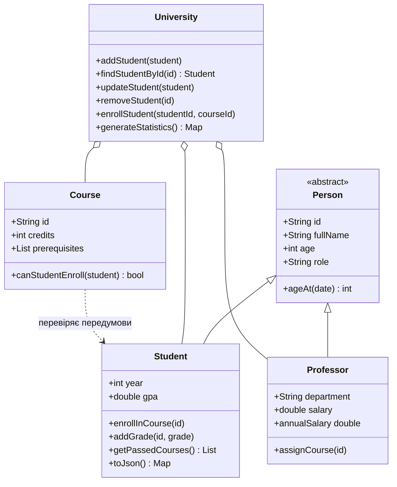

# Практична робота 4 · Основи мови Dart

**Дисципліна:** Програмування для мобільних платформ  
**Тема:** Змінні, функції, ООП, колекції та асинхронність  
**Дата:** 29.10.2026  
**Назва репозиторію для публікації:** `dart-basics-dobrytskyi`

## Мета та результат

Створено п'ять консольних програм і модель університету. Приклади охоплюють базові типи, null safety, функції, спадкування, колекції, CSV/JSON, Future і Stream. Усі дані студентів і викладачів у демонстраціях синтетичні.

Проєкт підготовлено з допомогою ШІ як навчальну реалізацію. Перед захистом потрібно самостійно пройти приклади, пояснити код і виконати власну зміну. Історія Git відображає фактичні етапи цієї підготовки, а не вигадану історію роботи студента.

**Фактично перевірено:** Dart SDK 3.9.2, Linux x64; 5 програм успішно запущено та скомпільовано в native executable; 33 тести пройдено; `dart analyze` — `No issues found!`. Виміряне покриття виконуваних рядків `lib/`: 330/330 (100%). Це не покриття всіх гілок, усіх можливих даних або `bin/`.

Публічний GitHub-репозиторій ще потрібно створити у власному обліковому записі. Архів містить локальну історію Git з понад 15 змістовними комітами. Посилання на нестворений репозиторій не наводиться.

## Установлення і швидкий запуск

1. Установити Dart SDK за офіційною інструкцією: https://dart.dev/get-dart. Можна використати Dart, який постачається з Flutter.
2. Для відтворення перевірок використати **Dart 3.9.2**. Мінімум цього пакета — 3.9.0 (це відповідає вимозі завдання «3.0.0 або новіша»). Версії залежностей зафіксовано в `pubspec.lock`.
3. На Windows додати `dart-sdk/bin` до PATH і відкрити новий термінал. У VS Code встановити розширення Dart.
4. Розпакувати ZIP і відкрити термінал у каталозі `dart_basics_dobrytskyi`, поряд з `pubspec.yaml`.

```sh
dart --version
dart pub get
dart analyze --fatal-infos
dart test
```

Для першого `pub get` потрібен інтернет. Команди файлових прикладів запускати **з кореня проєкту**, щоб відносні шляхи `data/` і `reports/` були правильними.

## П'ять програм

| Файл | Зміст | Команда |
| --- | --- | --- |
| task1_variables.dart | Типи, оператори, колекції, null safety, калькулятор | `dart run bin/task1_variables.dart` |
| task2_functions.dart | Параметри, рекурсія, замикання, аналіз тексту | `dart run bin/task2_functions.dart` |
| task3_classes.dart | Університет, CRUD, передумови, поліморфізм | `dart run bin/task3_classes.dart` |
| task4_collections.dart | CSV, сортування, групування, звіти | `dart run bin/task4_collections.dart` |
| task5_async.dart | Future.wait, timeout, Stream, JSON I/O | `dart run bin/task5_async.dart` |

### Калькулятор із власними аргументами

```sh
dart run bin/task1_variables.dart 12 '+' 8
dart run bin/task1_variables.dart 7 '/' 2
dart run bin/task1_variables.dart 2 '^' 10
dart run bin/task1_variables.dart 5 '/' 0
```

Підтримано `+`, `-`, `*`, `/`, `%`, `^`. Операцію передавати в лапках, особливо `*`. Некоректний формат, нескінченні числа, невідома операція та нульовий дільник дають повідомлення і код завершення 64. Результати типу double мають звичайну похибку двійкової арифметики; дуже великі степені можуть переповнювати double.

### Власний текст

```sh
dart run bin/task2_functions.dart 'Dart — це цікаво. Dart допомагає вчитися!'
```

Аналізатор нормалізує регістр, враховує українські літери, цифри й внутрішній апостроф; рахує частоти слів та кількість Unicode-кодових точок. «Символи» тут означають `runes`, а не графемні кластери: складний emoji може містити декілька кодових точок.

## Організація коду

- `bin/`: п'ять точок входу з пояснювальним виводом.
- `lib/models/`: Person, Student, Professor, Course, University.
- `lib/utils/calculator.dart`: арифметика, середнє, форматування ПІБ, рекурсія, замикання.
- `lib/utils/data_processor.dart`: текст і колекції.
- `lib/utils/csv_loader.dart`: перевірка та імпорт CSV.
- `lib/services/student_service.dart`: імітація API, JSON I/O, потік, вимірювання часу.
- `lib/demo_data.dart`: узгоджений набір викладача й курсів.
- `data/`: однакові синтетичні дані шести студентів у CSV та JSON.
- `test/`: модульні перевірки моделей, утиліт та асинхронних операцій.
- `docs/`: фактичний stdout, аналізатор, компіляція та ілюстрації виводу.
- `reports/`: згенеровані результати аналізу, покриття і графіки.
- `tool/verify.sh`: повний цикл перевірок для shell.
- `.github/workflows/dart.yml`: перевірки GitHub Actions після публікації.

## ООП і UML



Person винесено в окремий файл, щоб Student і Professor успадковували один контракт без циклічних імпортів. `university.dart` також експортує Person і Professor для зручності. Поліморфізм демонструється списком `List<Person>` і викликом `role` для різних об'єктів.

Колекції оцінок, записів на курси та навичок захищено від зовнішньої зміни. Конструктори копіюють вхідні колекції. Редагування студента виконується заміною об'єкта з тим самим ID через `updateStudent`.

### Приклад класів

```dart
final university = createDemoUniversity();
final student = Student(
  id: 'S99',
  firstName: 'Анна',
  lastName: 'Романюк',
  birthDate: DateTime(2005, 5, 20),
);
university.addStudent(student);
university.enrollStudent('S99', 'CS101');
student.addGrade('CS101', 88);
print(student.gpa); // 88.0
print(university.getAvailableCoursesForStudent('S99')); // CS102
```

Імпорти для прикладу: `package:dart_basics_dobrytskyi/demo_data.dart` та `package:dart_basics_dobrytskyi/models/student.dart`.

### Бізнес-правила та домовленості

- ID у межах кожного реєстру унікальні; невідомі об'єкти дають StateError.
- Оцінка: скінченне число 0..100; складений курс — оцінка від 60 включно.
- GPA означає **середню оцінку 0..100**, без ваги кредитів, а не американську шкалу 4.0.
- Для студента без оцінок `gpa=0`; при обчисленні середнього GPA університету такі студенти виключаються.
- Рік навчання — окреме поле `year` (1..6), не рік народження.
- Вступ на курс через `University.enrollStudent` потребує складених передумов; повторний запис відхиляється.
- `Student.enrollInCourse` — нижчий рівень: він перевіряє лише непорожній код і відсутність дубліката. Для бізнес-операцій використовувати University.
- При імпорті історичних записів перевіряються відомі коди курсів, але передумови не застосовуються заднім числом: CSV може містити незавершене навчання.
- Передумови не можуть бути циклічними. Під час первинного додавання курсів передумови вже мають існувати.
- Видалити курс із записаними студентами або залежними курсами не можна. Видалити викладача, на якого посилається курс, не можна.
- `Course.instructor` — ID викладача. `Professor.taughtCourses` — окремий демонстраційний список призначень; він не є автоматично синхронізованим з усіма змінами `Course.instructor`.
- Вік враховує місяць і день народження. Дата 29 лютого в невисокосний рік за цією реалізацією досягає річниці 1 березня.

## Колекції та файли

CSV містить колонки `id,firstName,lastName,birthDate,year,skills,enrolledCourses,grades`. Навички й коди курсів розділені `|`, оцінки збережено JSON-об'єктом усередині CSV-комірки. Бібліотека csv обробляє лапки, коми та вкладені лапки. Заголовок, число колонок і дублікати ID перевіряються.

```sh
dart run bin/task4_collections.dart data/students.csv
```

`map` створює нове представлення, `where` відбирає елементи, `fold` дозволяє початковий акумулятор, `reduce` вимагає непорожньої колекції. Сортування рейтингу працює з копією списку, тому початковий порядок не змінюється. За однакового GPA використано ID як додатковий ключ.

На наданих даних: 6 студентів; 5 мають оцінки; середнє студентських GPA — 78,5. Середня оцінка CS101 — 80,4; CS102 — 81,33. Найвищий GPA — 95,0. Студент без оцінок має 0 у рейтингу, але не знижує загальне середнє.


Файли `reports/analysis.json`, `course_averages.csv` та `processed_students.json` створені робочими програмами. Повторний запуск оновлює їх. Графік показує збережений запуск; після нових вимірювань його можна оновити через `python tool/render_reports.py` (додатково потрібні matplotlib і Pillow для зображень).

## Асинхронність і швидкодія

`fetchStudentData` імітує API через Future.delayed. Реального HTTP немає. `Future.wait` одночасно очікує незалежні операції. `.timeout` обмежує очікування, але **не скасовує** початковий Future. Приклад обробляє збій та TimeoutException.

`studentStream` — скінченний async*-генератор. Його результати обробляються через `where`, `map`, `listen`; підписка закривається в `finally` через `cancel()`. Власний StreamController не потрібен для цієї роботи, оскільки потік створює async*.

JSON-конвеєр читає файл, обробляє студентів незалежними асинхронними операціями, додає навичку Async до нових об'єктів, записує їх та перевіряє повторним читанням. Окремо показано обробку відсутнього файла.

| Вимірювання | Фактичний результат збереженого запуску |
| --- | ---: |
| 3 запити по 100 мс, послідовно | 303,839 мс |
| Ті самі запити через Future.wait | 101,479 мс |
| Відношення часу | 2,994 |

Значення отримано Stopwatch, джерело — `reports/async_benchmark.json`. Це один запуск імітованого I/O, не доказ прискорення CPU-обчислень. Час залежить від планувальника й навантаження. Task4 додатково вимірює читання CSV і 1000 сортувань шести студентів; дані зберігаються в `analysis.json.performance`. Малий набір та JIT-прогрів обмежують застосовність цих оцінок.

## Перевірка якості

```sh
dart format --output=none --set-exit-if-changed bin lib test
dart analyze --fatal-infos
dart test --reporter expanded --concurrency=1 --coverage=coverage/raw
dart run coverage:format_coverage --lcov --in=coverage/raw --out=reports/lcov.info --packages=.dart_tool/package_config.json --report-on=lib
```

- `test/models_test.dart`: день народження, оцінки, інкапсуляція, JSON, CRUD, передумови та цикли.
- `test/utils_test.dart`: арифметика, рекурсія, замикання, Unicode, CSV, сортування і групування.
- `test/async_test.dart`: помилки, timeout, JSON round-trip, потік і вимірювання.
- `docs/test_results.txt`: 33 успішні тести.
- `docs/analyze.txt`: чистий аналізатор.
- `docs/compile_results.txt`: компіляція п'яти програм.
- `reports/coverage_summary.md`: звіт за файлами; `reports/lcov.info`: машинний формат.

Для власної компіляції, наприклад:

```sh
dart compile exe bin/task3_classes.dart -o university_demo.exe
```

Розширення `.exe` зручне для Windows; код компілюється для операційної системи, де виконується команда. Linux-бінарні файли, SDK, кеш залежностей та build/ в архів не включено.

## Ілюстрації фактичного виводу

Наведені PNG — програмно оформлені ілюстрації **реального stdout**, збереженого після запуску. Вони не є скриншотами браузера, VS Code або термінала студента. Автоматичне створення браузерних скриншотів у цьому середовищі було заблоковано обмеженням запуску Chromium. Відповідний текст без змін доступний у `docs/task*_output.txt`, а сторінки перегляду — у `docs/task*.html`.


Для виконання вимоги про скриншоти запустити програми у власному терміналі й додати ці знімки. В архіві їх поки немає; ілюстрації журналів не підміняють цей етап. Жива демонстрація та пояснення коду виконуються студентом.

## Публікація GitHub без втрати історії

1. Створити **порожній публічний** репозиторій `dart-basics-dobrytskyi`, без автоматичного README та .gitignore.
2. Розпакувати архів зі збереженням каталогу `.git`. Перевірити `git log --oneline`.
3. У корені проєкту виконати команди, підставивши власний логін:

```sh
git remote add origin https://github.com/YOUR_LOGIN/dart-basics-dobrytskyi.git
git push -u origin main
```

`YOUR_LOGIN` — заповнювач, а не створене посилання. GitHub може запросити вхід через Git Credential Manager або токен. Завантаження файлів через вебформу не переносить локальну історію комітів; для вимоги 15+ комітів потрібно push. Не змінювати автора попередніх комітів на студента; власні зміни комітити зі своїми налаштуваннями Git.

GitHub Actions після push перевірить форматування, аналіз, тести та запуск. Цей workflow підготовлено, але його виконання на GitHub ще не підтверджене. У Classroom передати адресу створеного репозиторію.

## Підготовка до захисту

1. Пояснити, чим відрізняються `final`, `const` і `late`.
2. Показати, як замикання зберігає незалежний лічильник.
3. Продемонструвати відмову в записі на CS102 до складання CS101.
4. Змінити оцінку в CSV, повторно запустити аналіз і пояснити нове середнє.
5. Пояснити, чому Future.wait скорочує час очікування, але не створює CPU-паралелізм.
6. Самостійно додати `getExcellentStudents(minGpa)` і тест граничного значення.

Обмеження моделі: немає бази даних, авторизації чи постійного сховища реєстру; CSV має фіксовану схему; Student.fromJson очікує її типи; зміна instructor не синхронізує демонстраційний список викладача автоматично. Програми призначені для навчання основ мови.

## Джерела

Офіційна документація; дата звернення 29.10.2026. Реалізація створена для цього завдання, а не скопійована зі зразка застосунку.

- Установлення SDK: https://dart.dev/get-dart
- Future, async та await: https://dart.dev/libraries/async/async-await
- Інструмент покриття: https://pub.dev/packages/coverage
- Документацію API згенеровано командою `dart doc`: 10 бібліотек, 0 попереджень та помилок. Відкрити `doc/api/index.html`; повторна генерація виконується тією самою командою.
